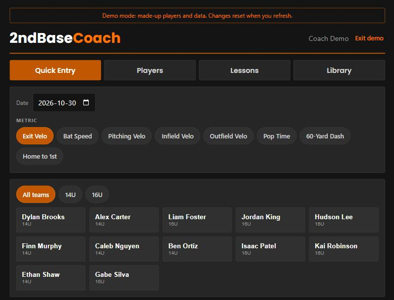
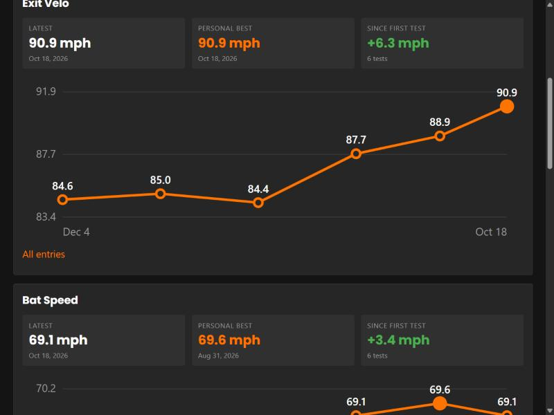
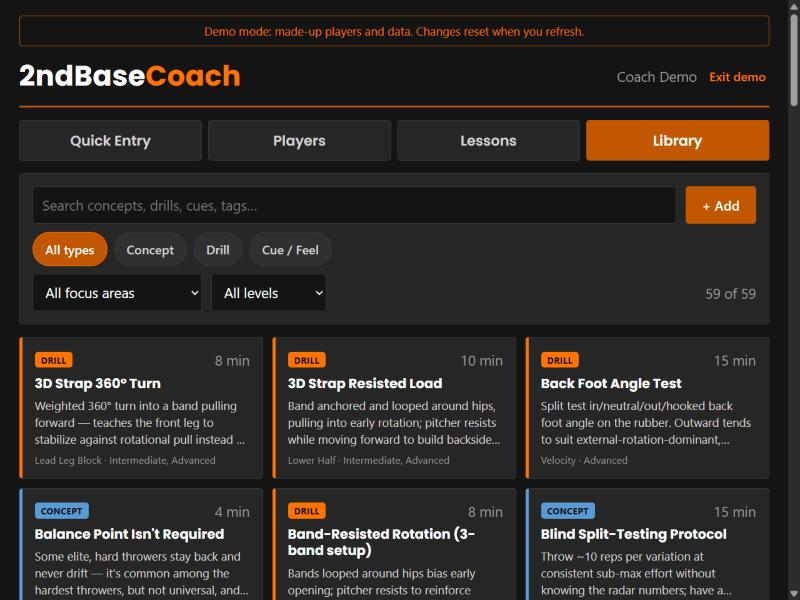

# 2ndBaseCoach

*Every team has a 1st and 3rd base coach. This is the one in between.*

An all-in-one baseball coaching app covering pitching, hitting, defense and more, designed to be used on an iPad at the field. I built it for my own coaching (12U–19U, Mississauga Tigers High Performance Program) and use it with real players, with the goal of making it work for any coach or program.

**▶ [Try the live demo](https://tigers-coach-app.vercel.app/?demo)**: no sign-up needed. It runs on made-up players and data, never touches the real database, and resets when you refresh.

| Quick Entry at the field | Player progress | Drill library |
|---|---|---|
|  |  |  |

**Built by:** James Markham, solo, with [Claude Code](https://claude.com/claude-code) as an AI pair programmer.
**Highlights:** React + TypeScript, Postgres with Row Level Security, a hand-drawn SVG chart (no chart library), autosave, a verified backup script, and an in-memory demo mode that stands in for the database.

**What works now:**
- **Coach login.** Each coach only ever sees their own players and data.
- **Quick Entry for testing days.** Pick a metric, then tap a player, type the number and save. Players already measured that day get a check mark. It flags new personal bests.
- **Players.** Roster grouped by team. Add, edit or archive players. Archived players are hidden, never deleted.
- **Player page.** For each metric: latest result, personal best, change since the first test, a progress chart and the full history.
- **Built-in metrics:** Exit Velo, Bat Speed, Pitching Velo, Infield Velo, Outfield Velo, Pop Time, 60-Yard Dash, Home to 1st.
- **Pitching library.** Concepts, drills and cues, filterable by type, level and focus area. Load the 59-entry starter library or import an export from the old pitching app.
- **Lesson plans and lesson log.** Build reusable lesson plan templates, start a lesson for a player from a plan, check off items, comment on how each went, and add dated follow-up notes. Notes autosave.
- **Backup script.** Exports everything to dated JSON + CSV files and verifies them.

- **Hosted on Vercel** and installable on an iPad or iPhone home screen (Safari → Share → Add to Home Screen).

**Coming next:** quick lesson notes, an intake questionnaire, a schedule, nightly backups, team practice plans and parent reports.

## How it works

There's no custom server. The browser app talks straight to Supabase, which provides the database, the logins and the security rules:

1. A coach signs in with Supabase Auth, which gives the app a login token.
2. Every read and write goes to Supabase's Postgres database with that token.
3. **Row Level Security** (rules inside the database) adds "only rows where `coach_id` is this coach" to every query, so one coach can never see another coach's players, even if the app had a bug.
4. The app only ever holds the *publishable* key, which is safe in a browser because of those rules. Secret keys are never used.

**Demo mode** (`?demo` in the URL) swaps the Supabase client for an in-memory fake (`src/lib/demoClient.ts`) that implements just the query calls the app uses: `select`, `insert`, `update`, `upsert`, `delete`, filters and ordering. Every screen runs unchanged on generated sample data (`src/lib/demoData.ts`, a seeded random generator, so it looks the same on every visit). No network request ever reaches the database, so real players' data stays private.

## Stack

- **App:** React + TypeScript, built with [Vite](https://vite.dev), hosted on [Vercel](https://vercel.com) (every push to `main` deploys)
- **Database:** [Supabase](https://supabase.com) (hosted Postgres + Auth)
- **Scripts:** Python 3.10+ (`backup.py` is standard library only; `transcript.py` needs `requirements.txt`)

## Setup

1. Install [Node.js](https://nodejs.org) 20 or newer and [Python](https://python.org) 3.10 or newer.
2. Install dependencies:
   ```bash
   npm install
   pip install -r requirements.txt
   ```
3. Copy `.env.example` to `.env.local` and fill it in:
   - The Supabase URL and **publishable** key (Supabase dashboard → Project Settings → API Keys).
   - `COACH_EMAIL` / `COACH_PASSWORD`: your app login. The backup script uses these.

## Run

```bash
npm run dev
```

Open the URL it prints (usually http://localhost:5173). The first time, choose "Create an account" and confirm the email Supabase sends you.

**No Supabase project?** Skip step 3 of Setup and open http://localhost:5173/?demo to run the whole app on sample data.

**To test on the iPad on the same wifi:**

```bash
npm run dev -- --host
```

Then open the "Network" URL it prints in Safari on the iPad.

## Back up your data

```bash
python scripts/backup.py
```

This creates `backups/<date_time>/` with a `.json` and a `.csv` for each table, plus a `manifest.json` with row counts. It re-reads the files to verify them before printing **Backup OK**. The `backups/` folder is kept out of git because it holds players' personal info. OneDrive syncs it, which gives you an off-site copy.

## Add a YouTube video to the library

In Claude Code, from this folder:

```
/add-video https://www.youtube.com/watch?v=...
```

It fetches the transcript (`scripts/transcript.py`), drafts drills, cues and concepts, and shows you a preview. Nothing is saved until you approve it. Each item's `source` is the video link with a timestamp (`&t=95s`), so it opens where that drill is explained. Videos already imported are skipped. The skill's steps are in `.claude/skills/add-video/SKILL.md`.

To just read a transcript: `python scripts/transcript.py <youtube-url>`

## Database

Schema changes live in `supabase/migrations/` in the order they were applied. `supabase/tests/rls_check.sql` proves that each coach can only see their own data. Run it after every schema change. It cleans up after itself.

## Other commands

| Command | What it does |
|---|---|
| `npm run build` | Type-checks and builds the production version into `dist/` |
| `npm run lint` | Checks the code for common mistakes |
| `npm run preview` | Serves the production build locally |
